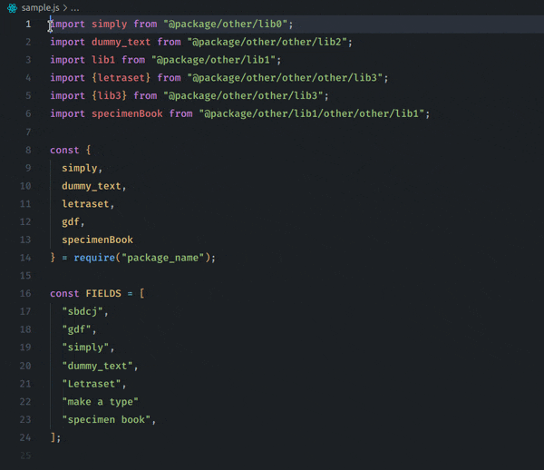
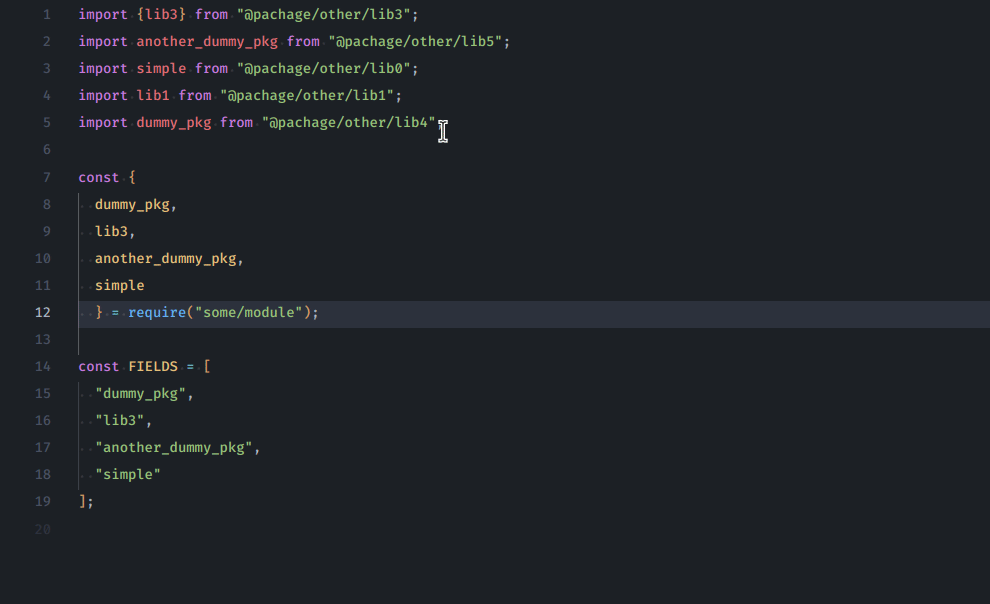

#  Ordinator [](https://github.com/thiagopsnfg/ordinator/blob/master/LICENSE)

### The easiest way to sort any selection you have in your project, whether it's your imports, exports or any other selection

## Usage 📚

#### Order line with vertical selection. (vscode vertical selection) 📏



#### Order line with normal selection. (mouse or selection) 🖱️



### Default Keymap ⌨️

**Win/Linux:**  
<kbd>ctrl</kbd> + <kbd>alt</kbd> + <kbd>O</kbd>  
<kbd>ctrl</kbd> + <kbd>shift</kbd> + <kbd>O</kbd> => Order

**Mac:**  
<kbd>cmd</kbd> + <kbd>alt</kbd> + <kbd>O</kbd>  
<kbd>cmd</kbd> + <kbd>shift</kbd> + <kbd>O</kbd> => Order

## Sort on save 💾

Ordinator provides **source code actions** that you can run automatically when saving a file, via VS Code's `editor.codeActionsOnSave`. Choose where to apply it:

```jsonc
// settings.json
"editor.codeActionsOnSave": {
  "source.ordinator.sortImports": "explicit", // only imports / requires
  "source.ordinator.sortExports": "explicit"  // only exports
  // or "source.ordinator": "explicit" to sort both
}
```

> On VS Code versions older than 1.85 use `true` instead of `"explicit"`.

You can also scope it per language:

```jsonc
"[typescript]": {
  "editor.codeActionsOnSave": { "source.ordinator.sortImports": "explicit" }
}
```

The same actions are available on demand from **Source Action...** in the context menu and from the command palette (`Ordinator: Sort Imports` / `Ordinator: Sort Exports`).

What gets sorted (shortest line first, same as *Order Selection*):

* **Imports**: the `import ... from '...'` / `const x = require('...')` block at the top of the file is merged into a single block and sorted. `import` and `require` statements are kept as separate groups, comments directly above an import move with it, and side-effect imports such as `import './styles.css'` keep their position. Shebangs, `'use strict'` and comments before the first import stay at the top.
* **Exports**: each contiguous block (no blank lines in between) of `export { ... }` / `export ... from '...'` statements starting at column 0. Declarations like `export const` are never moved.
* **Specifiers**: names inside braces, e.g. `import { useState, a }` → `import { a, useState }` (skipped when the braces contain comments).

### Settings ⚙️

| Setting | Default | Description |
| --- | --- | --- |
| `ordinator.languages` | `["javascript", "javascriptreact", "typescript", "typescriptreact"]` | Languages where the code actions are offered |
| `ordinator.sortSpecifiers` | `true` | Also sort names inside `{ }` |
| `ordinator.includeRequire` | `true` | Treat top-level `require` statements as imports |

## Contributors 👥

* [Thiago P. Santos](https://github.com/thiagopsnfg/)

## LICENSE 📄

[LICENSE](./LICENSE)

**Enjoy!** 🎉
